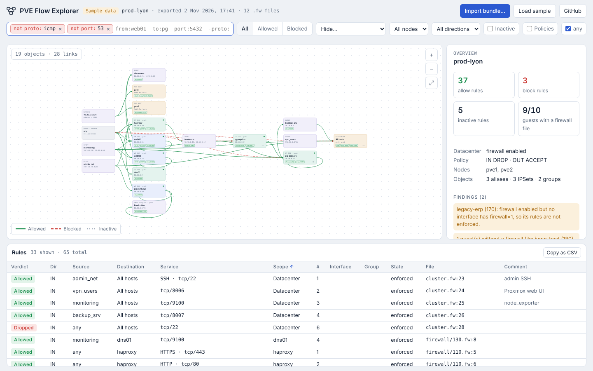

# PVE Flow Explorer

Audit the **Proxmox VE firewall** of a cluster as a service map, in the spirit of Cilium's Hubble UI.

- **`pve_fw_export.py`** runs on a PVE node and exports the raw firewall configuration as a JSON bundle.
- **The web app**, a single page at **https://pve-flow-explorer.w00tw00t.me**, imports that bundle and lets you explore and filter every flow.



The web app is static. The bundle is parsed and resolved **in your browser** and is never uploaded anywhere.

---

## Quick start

On any node of the cluster (as root):

```bash
curl -fsSLO https://raw.githubusercontent.com/mrwazaby/pve-flow-explorer/main/pve_fw_export.py
python3 pve_fw_export.py
# Bundle written: /root/pve-fw-<cluster>-<date>.json
```

Then open https://pve-flow-explorer.w00tw00t.me and click **Import bundle…**. The import dialog repeats these steps, with copy buttons, and lets you choose the file, drop it, or paste its JSON content into a text box.

To paste instead of copying the file around, print the bundle and copy it from your terminal:

```bash
python3 pve_fw_export.py -o -
```

The paste box tolerates the command line and shell prompt around the JSON. If your terminal hard-wraps long lines when copying, import the file instead.

Python 3.6+ with the standard library only. Nothing to install.

---

## The extractor: `pve_fw_export.py`

The extractor does not interpret anything. It copies the configuration files as they are, so the bundle stays a faithful snapshot and all the logic lives in one place (the web app).

```text
usage: pve_fw_export.py [--pve-dir DIR] [-o FILE]

  --pve-dir DIR   PVE config root (default: /etc/pve). Use it on an offline copy.
  -o FILE         output file, '-' for stdout (default: ./pve-fw-<cluster>-<date>.json)
```

To run it from your workstation without copying the script to the node, pipe it through SSH:

```bash
ssh root@pve1 python3 - -o - < pve_fw_export.py > pve-fw-export.json
```

### What goes into the bundle

| Key      | Content |
|----------|---------|
| `files`  | Raw text of `firewall/cluster.fw`, `firewall/<vmid>.fw`, `nodes/<node>/host.fw`, `sdn/firewall/<vnet>.fw`, `sdn/vnets.cfg`, `sdn/subnets.cfg`, `sdn/zones.cfg` |
| `guests` | For each VM/CT: node, type and only these lines of its `.conf`: `name`, `hostname`, `net*`, `ipconfig*`, `tags`, `template`. Snapshot sections are dropped. |
| `nodes`  | Node names |
| `live`   | VM/CT status, IPs reported by the QEMU guest agent or LXC interfaces, node IPs. Collected with `pvesh` when reading `/etc/pve` on a node; `null` with `--pve-dir` or when `pvesh` is missing. |
| `meta`   | Cluster name, export host, timestamp, `pveversion` |

**Not exported:** cloud-init passwords (`cipassword`), SSH keys, descriptions, disks, storage, users, tokens and anything else in `/etc/pve`.

The bundle still describes your network layout and firewall policy, so handle it like any other sensitive config file. `.gitignore` excludes `pve-fw-*.json` for that reason.

### Why the live data?

The firewall rules reference IP addresses, while VM configs only contain IPs when they are set statically (LXC `ip=` or cloud-init `ipconfigN`). The IPs reported by the guest agent are added too, so a rule such as `-source 10.10.0.21` is shown as a flow from `pg-primary` instead of a bare address.

Each `pvesh` call starts a Perl process, and calls for another node go through SSH, so this is the slow part of the export. To keep it bounded:

- only running guests are asked, and only VMs whose config has the guest agent enabled (`agent: 1`);
- up to 6 calls run in parallel, each one is killed after 15 s (a guest agent that does not answer), and the whole step stops after 60 s;
- guests that did not answer in time keep the IPs from their config, and the exporter says how many calls were answered.

A small cluster takes a few seconds.

---

## The web app: PVE Flow Explorer

### Layout

- **Service map** (centre): one card per VM, CT, PVE host, IPSet, alias, network or VNet. Ports exposed by a rule appear as chips on the destination card.
  - Links are solid green when allowed, dashed red when dropped or rejected, and dotted grey when inactive.
  - `any` is split into a **source** card on the left and a **destination** card on the right, like `world` in Hubble.
- **Side panel** (right): an overview with findings by default. Click a card to see its inbound and outbound peers, a link to list its rules, or a table row to inspect one rule. The rule view shows the file and line, its position in the chain, the original line and the security group that pulled it in.
- **Rule table** (bottom): sortable, and filtered by the current selection. **Copy as CSV** copies the visible rows.

### Filters

Type in the filter box. **Enter** pins a filter as a chip, **Backspace** on an empty box removes the last chip, and **/** focuses the box. Chips are combined with AND.

| Filter | Matches |
|--------|---------|
| `from:web01` | rules whose source card matches (name, VMID, IP, tag, node) |
| `to:pg` | rules whose destination card matches |
| `ip:10.10.0.0/24` | rules where either side overlaps this address or CIDR (IPv4) |
| `port:5432`, `port:5400-5420` | rules whose destination ports overlap |
| `proto:udp` | rules for this protocol, or for any protocol |
| `node:pve1` | rules touching a guest or host of this node |
| `group:db` | rules coming from a security group |
| `scope:pve1`, `scope:101.fw` | rules defined in a given scope or file |
| `action:drop` | `accept`, `drop` or `reject` |
| free text | names, services, comments, raw rule text |

**Excluding traffic:** prefix any filter with `-` (or `!`). Excluded chips are shown in red.

| Exclusion | Hides |
|-----------|-------|
| `-proto:icmp` | ICMP rules, including the `Ping` macro and ICMPv6 |
| `-port:53` | rules whose ports are all inside 53, such as DNS |
| `-port:5900-5999` | rules entirely within that range |
| `-from:any` | rules whose source is `any` |
| `-monitoring` | anything mentioning "monitoring" |

Exclusion by port or protocol only hides a rule when its **whole** service falls in the excluded set, so `-port:53` hides DNS rules but keeps a rule that allows every port. The **Hide…** menu adds common exclusions in one click: ICMP, DNS, NTP, SSH, DHCP, node_exporter and all UDP. Chips are remembered in your browser.

The other controls narrow the view further:
- **All / Allowed / Blocked**: show every rule, only allowing rules, or only dropping and rejecting rules.
- **Node**: like Hubble's namespace selector.
- **Direction**: `IN`, `OUT` or `FORWARD`.
- **Inactive**: also show disabled rules and rules whose firewall is off.
- **Policies**: also show the default `policy_in` / `policy_out`.
- **any**: show or hide flows from or to `any`.

### Findings

The overview lists configuration issues found while resolving the bundle:

- the datacenter firewall is disabled, so nothing is enforced;
- a guest has `enable: 1` but none of its NICs has `firewall=1`, so its rules are not enforced;
- a guest has no `.fw` file;
- an alias, IPSet, security group or macro is referenced but not defined.

---

## How rules are interpreted

- **Scopes**:
  - `cluster.fw` rules target **All hosts** (the PVE nodes themselves).
  - `host.fw` rules target that node.
  - `<vmid>.fw` rules target the guest.
  - `sdn/firewall/<vnet>.fw` rules target the VNet (`FORWARD`).
- **Direction**: for `IN` rules, a missing `-dest` means the target. For `OUT` rules, a missing `-source` means the target. A missing address means `any`.
- **Aliases and IPSets** are resolved with PVE's lookup order: guest-local first, then datacenter. The `dc/` and `guest/` prefixes are supported, as are `!` negation and nested aliases in IPSets.
- **IP → guest**: when an address or a single-member IPSet is a host address belonging to a guest (static IP, cloud-init or guest agent), the flow is drawn to or from that guest's card. A CIDR that matches an SDN subnet is shown as its VNet.
- **Security groups** (`GROUP name -i net0`) are expanded inline. Each expanded rule keeps a reference to the line that called the group.
- **Macros** (`SSH(ACCEPT)`, `PostgreSQL(ACCEPT)`, `Ceph(ACCEPT)`…) are mapped to protocols and ports by a built-in table of the common PVE macros.
- **State**: a rule is *enforced* only if it is enabled, its firewall file has `enable: 1`, the datacenter firewall is enabled and, for guests, at least one NIC has `firewall=1`.
- **Order**: `#` is the rule position in its chain. PVE applies the first matching rule, then the default policy.

### Known limitations

- The app shows the **policy** (what the rules say), not observed traffic.
- There is no full first-match evaluation yet: a rule shadowed by an earlier one is still drawn.
- IP matching for `ip:` filters is IPv4-aware. IPv6 addresses are compared as text.
- Macros missing from the built-in table are listed under findings and shown with unknown ports.
- `ipfilter-netX` IPSets (IP spoofing filters) are ignored. `-icmp-type` is displayed but not evaluated.

---

## Repository layout

```text
pve_fw_export.py            extractor (single file, stdlib only)
web/src/app.html            web app source (HTML + CSS + JS, no build step besides injection)
web/index.html              built page, with the sample bundle embedded
web/CNAME                   custom domain for GitHub Pages
tools/build_web.py          injects examples/demo-bundle.json into the app → web/index.html
examples/demo-etc-pve/      fictional /etc/pve tree used for the sample data
examples/demo-bundle.json   bundle exported from that tree
.github/workflows/pages.yml builds and deploys web/ to GitHub Pages
```

### Development

```bash
python3 tools/build_web.py                 # rebuild web/index.html
python3 -m http.server -d web 8080         # http://localhost:8080
```

To refresh the sample data after editing `examples/demo-etc-pve/`:

```bash
python3 pve_fw_export.py --pve-dir examples/demo-etc-pve -o examples/demo-bundle.json
python3 tools/build_web.py
```

The only external resource is the IBM Plex font from Google Fonts, with system fallbacks. There is no analytics and no backend. The last imported bundle and your filters are kept in `localStorage` in your own browser.

### Deployment

`.github/workflows/pages.yml` publishes `web/index.html` and `web/CNAME` on every push to `main`. One-time setup:

1. In the repository, go to **Settings → Pages** and set **Source** to **GitHub Actions**.
2. At your DNS provider, add `pve-flow-explorer.w00tw00t.me CNAME mrwazaby.github.io.`
3. Once the certificate is issued, tick **Enforce HTTPS** in **Settings → Pages**.

Any other static host works too: serve `web/index.html` as the index page.
